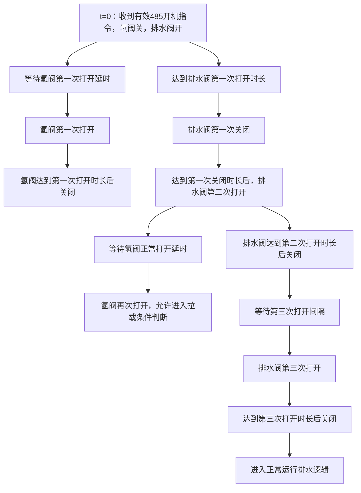
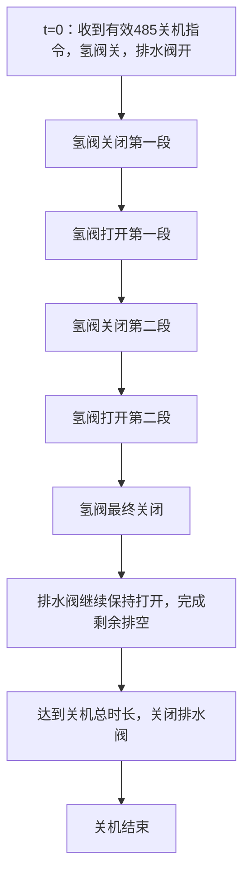

# FCU 氢燃料电池控制器上位机客户需求规格说明书

| 项目 | 内容 |
|---|---|
| 文档版本 | V0.4（上位机实现与 UI 验证记录） |
| 整理日期 | 2026-08-17 |
| 原始需求 | [260816客户需求.md](./260816客户需求.md) |
| 文档状态 | SOC 新增协议已按规格接入上位机；当前下位机程序尚未更新，其余固件协议、设备动作与联机验收仍待完成 |
| 实施分支 | `codex/customer-core-parameter-ui`（不合并） |

## 1. 编写目的

本文档对客户 2026-08-16 提出的界面与控制逻辑需求进行结构化整理，重点明确：

- BMS/SOC 参数区的紧凑布局；
- 压力参数区的界面尺寸调整；
- 温度负数输入与双风扇控制；
- 开机、正常运行和关机过程中的氢阀/排水阀时序；
- 时序图形化编辑、参数校验、设备读写和验收标准；
- 当前描述中仍需客户或下位机开发人员确认的内容。

原始需求图片中的数值均为界面或时序示例值，不是最终默认值。需求规格已明确的 SOC 默认值 `90/85/60/8 Ah` 除外；其他默认值、协议字段、计时精度和安全边界仍须由客户与下位机开发人员确认。

## 2. 需求范围与优先级

| 优先级 | 需求模块 | 说明 |
|---|---|---|
| P0 | 开机氢阀/排水阀时序 | 客户明确指出这是整个开机逻辑中最重要的流程 |
| P0 | 关机氢阀/排水阀时序 | 关机时序与开机不同，必须单独建模和校验 |
| P1 | 正常运行排水逻辑 | 支持定时或压力触发，低压反馈阈值可设置 |
| P1 | 温度与双风扇 | PT1000 电堆温度支持负值；风扇 2 使用待机、拉载两档；手动控制区分两路风扇 |
| P1 | BMS/SOC 参数 | 支持开机拒启、运行停机、关机充电阈值及电池容量设置 |
| P2 | UI 紧凑化 | SOC 参数排成一行，压力输入框缩短，时序参数使用图形化布局 |

## 3. 已确认的总体约束

1. 图片中的数值只用于说明界面与时序，不作为最终默认值。
2. 电流不需要标定，只保留一套电流参数，不增加轻载、重载等多套配置。
3. 压力区不再增加额外的“低压/高压工作区间”分组，只保留本需求规定的限制值、当前值和传感器量程。
4. 所有客户参数框均应可设置；实时采集的“当前值”仅显示，不允许编辑。
5. 上位机应能手动控制氢阀和排水阀，但必须以下位机提供安全、明确的控制协议为前提。
6. 风扇 2 没有转速反馈，其转速只能按占空比和额定转速模拟显示，界面必须明确标注“估算”或“模拟”，不得显示为实测值。
7. 下位机尚未提供的字段可以先完成界面设计，但不得伪造写入成功；应显示“等待固件协议”并禁用实际写入。SOC 参数已有明确协议，不再按此项禁用。

## 4. UI 布局需求

### 4.1 BMS/SOC 参数区

参考：[图 1](./图片/1.png)。

SOC 参数应使用一套配置并在同一行紧凑排列，不增加轻载、重载或强启等多套配置。顺序如下：

| 开机拒启上限 | 当前 SOC | 运行停机上限 | 关机充电下限 | 电池容量 |
|---|---|---|---|---|
| 可设置 | 只读 | 可设置 | 可设置 | 可设置 |

界面要求：

- 百分比字段统一显示 `%`，电池容量统一显示 `Ah`；
- 当前 SOC 使用只读样式，与可编辑参数框明显区分；
- 读取、写入和固化按钮应与参数行对齐，不得挤占参数显示区域；
- 在常用窗口尺寸下不得出现字段遮挡、单位换行或无必要的横向滚动。

### 4.2 压力参数区

参考：[图 2](./图片/2.png)。

- 保留“高压传感器”和“低压传感器”两行；
- 每行按“最低限制、当前值、最高限制、量程”排列；
- 输入框和当前值显示框应缩短，避免整行过宽；
- 当前值只读，最低限制、最高限制和量程可设置；
- 单位统一写为 `kPa`；
- 不新增红区、黄区或其他多余工作区间输入框。

### 4.3 温度与双风扇区

参考：[图 3](./图片/3.png)。

- 温度和双风扇参数继续集中在同一功能区；
- 风扇 1、风扇 2 的状态和参数必须分行显示；
- 风扇手动控制不得只保留一个共用值，应至少提供风扇 1、风扇 2 两个独立的手动设定值；
- 风扇 2 的模拟转速必须标注为“估算转速”，并同时显示对应百分比，便于操作人员理解。

### 4.4 阀门时序区

参考：[图 4](./图片/4.png)、[图 5](./图片/5.png)、[图 6](./图片/6.jpg)、[图 7](./图片/7.jpg)、[图 8](./图片/8.jpg)、[图 9](./图片/9.jpg)。

- 开机和关机必须分别使用相同风格的逻辑图或阶梯时序图；
- 图中至少包含“氢阀”和“排水阀”两条状态轨道；
- 高电平代表打开，低电平代表关闭，并在图例中明确说明；
- 横轴为时间，关键动作点应标注阶段名称；
- 参数输入框放在时序图下方，修改参数后图形应同步刷新；
- 正常运行排水参数单独展示，不与开机/关机一次性时序混在一起；
- “拉载风扇占空比”不属于阀门时序，应移回风扇或拉载参数区；
- 图形用于参数预览，不得在没有下位机阶段状态上报的情况下伪装成实时执行进度。

## 5. 参数与数据规则

### 5.1 BMS/SOC 参数

| 参数 | 单位 | 协议范围 | 属性 | 作用 | 默认值 |
|---|---:|---:|---|---|---|
| 开机拒启上限 `soc_start_max` | % | 1～100 | 可读写、写 Flash | 当前 SOC 大于该值时拒绝开机 | 90 |
| 当前 SOC | % | 0～100 | 只读 | 显示 BMS 实时 SOC | 不适用 |
| 运行停机上限 `soc_stop_high` | % | 1～100 | 可读写、写 Flash | 运行中 SOC 大于该值时自动停机 | 85 |
| 关机充电下限 `soc_stop_min` | % | 1～100 | 可读写、写 Flash | 关机时 SOC 低于该值，先充电至该值 | 60 |
| 电池容量 `battery_capacity` | Ah | 1～65535，整数 | 可读写、写 Flash | FCU 标称容量；当前仅存储和回读，不参与计算 | 8 |

三个 SOC 阈值按协议分别校验 `1～100`，不再增加 `强启 ≤ 开机 < 关机` 等协议未规定的关系校验。参数写入 Flash 后，须重启 FCU 才生效。

协议定义如下：

| 操作 | 功能码/参数ID | 数据域 |
|---|---|---|
| 写入 | 功能码 `0x10` | 固定 5B：`soc_start_max(1) + soc_stop_high(1) + soc_stop_min(1) + battery_capacity(2, 大端)`；不含参数ID |
| 写入响应 | 功能码 `0x90` | 1B 结果码；非法参数返回 `0x02` |
| 读取 | 功能码 `0x0A`，参数ID `0x0701` | 请求数据 `07 01 00` |
| 读取响应 | 功能码 `0x8A`，参数ID `0x0701` | `param_id(2) + sub_index(1) + 上述5B参数` |

当前 SOC 来自 BMS 寄存器 130，只读，不包含在上述 5B 配置中。

### 5.2 压力参数

| 参数组 | 可设置字段 | 只读字段 | 基本校验 |
|---|---|---|---|
| 高压传感器 | 最低限制、最高限制、量程 | 当前高压 | `0 ≤ 最低限制 < 最高限制 ≤ 量程`，量程必须大于 0 |
| 低压传感器 | 最低限制、最高限制、量程 | 当前低压 | `0 ≤ 最低限制 < 最高限制 ≤ 量程`，量程必须大于 0 |

参数超出量程、上下限倒置或量程为 0 时，上位机必须阻止写入并说明具体错误字段。

### 5.3 温度参数

- 电堆温度传感器确认为 **PT1000**，界面、协议注释和验收记录必须统一使用 PT1000；
- 温度输入必须支持负号和小数，例如 `-40.0 ℃`；
- 建议界面精度为 `0.1 ℃`，实际范围由下位机协议确认；
- 温度下限必须小于温度上限；
- 下位机必须使用有符号数存储和传输温度阈值，上位机不得把负数转换成无符号大数后发送；
- 非法格式、超范围或上下限倒置时禁止写入。

### 5.4 风扇参数

| 对象 | 自动控制需求 | 手动控制需求 | 转速反馈 |
|---|---|---|---|
| 风扇 1 | 保留现有温控逻辑，具体参数由协议确定 | 独立设置风扇 1 手动占空比/转速档 | 实测反馈 |
| 风扇 2 | 只保留“待机转速”和“拉载转速”两个工作档位 | 独立设置风扇 2 手动占空比/转速档 | 无反馈，按百分比模拟 |

补充规则：

- 占空比范围为 `0～100%`；
- 风扇 2 的待机档和拉载档应各有一个可设置值；
- 进入拉载状态时切换到拉载档，退出拉载后恢复待机档；
- 风扇 1、风扇 2 的手动值必须分别显示，不能用一个输入框冒充独立控制；
- 如果下位机仍只能输出一组共用 PWM，上位机应提示“当前固件不支持独立控制”，不得显示两路均已独立生效。

## 6. 阀门控制逻辑

### 6.1 状态定义

| 状态 | 氢阀 | 排水阀 |
|---|---|---|
| 打开 | 高电平/开 | 高电平/开 |
| 关闭 | 低电平/关 | 低电平/关 |

开机、正常运行和关机应使用独立参数，避免一个字段在不同阶段表达不同含义。

### 6.2 开机时序

开机时序统一以 FCU 收到有效的 RS485 开机指令，并由控制逻辑判定电堆需要开机的时刻作为 `t=0`。后续所有标注为“进入开机流程”的计时均从该时刻开始。

客户描述可整理为以下动作顺序：

1. `t=0` 时进入开机流程，排水阀立即打开并开始计算“排水阀第一次打开时长”；与此同时，氢阀保持关闭并开始计算“氢阀第一次打开延时”。两个计时器并行运行。
2. “氢阀第一次打开延时”到达后，第一次打开氢阀。
3. 氢阀保持打开“氢阀第一次打开时长”，随后关闭。
4. 排水阀第一次打开达到设定时长后关闭。
5. 排水阀保持关闭“排水阀第一次关闭时长”，随后第二次打开。
6. 排水阀第二次打开后开始计时，达到“氢阀再次打开延时”后再次打开氢阀；从此时起允许进入正常拉载条件判断。
7. 排水阀第二次打开达到设定时长后关闭。
8. 等待“排水阀第三次打开间隔”，第三次打开排水阀。
9. 排水阀第三次打开达到设定时长后关闭，随后进入正常运行排水计时。

建议的开机参数如下。所有值均使用秒显示：

| 参数编号 | 参数名称 | 计时起点 | 暂定输入范围 | 默认值 |
|---|---|---|---:|---|
| ST-01 | 氢阀第一次打开延时 | `t=0`：收到有效 RS485 开机指令并判定需要开机 | 0.00～9.99 s | 待确认 |
| ST-02 | 氢阀第一次打开时长 | 氢阀第一次打开 | 0.00～9.99 s | 待确认 |
| ST-03 | 排水阀第一次打开时长 | `t=0`：收到有效 RS485 开机指令，排水阀第一次打开 | 0.00～9.99 s | 待确认 |
| ST-04 | 排水阀第一次关闭时长 | 排水阀第一次关闭 | 0.00～9.99 s | 待确认 |
| ST-05 | 排水阀第二次打开后氢阀再开延时 | 排水阀第二次打开 | 0.00～9.99 s | 待确认 |
| ST-06 | 排水阀第二次打开时长 | 排水阀第二次打开 | 0.00～9.99 s | 待确认 |
| ST-07 | 排水阀第三次打开间隔 | 排水阀第二次关闭 | 0.00～9.99 s | 待确认 |
| ST-08 | 排水阀第三次打开时长 | 排水阀第三次打开 | 0.00～9.99 s | 待确认 |

已确认：

- 整个开机时序的起点是 FCU 收到有效 RS485 开机指令，并判定电堆需要开机的时刻；
- 在 `t=0` 时排水阀立即打开，ST-01 与 ST-03 同时开始计时；
- 氢阀第一次打开时刻为 `t = ST-01`，排水阀第一次关闭时刻为 `t = ST-03`；
- 氢阀再次打开的局部计时起点是排水阀第二次打开时刻，即动作关系为“排水阀打开 → 等待设定延时 → 氢阀再开”，不是从氢阀第一次打开时刻开始计时。

为保证氢阀确实经历“第一次打开—关闭—再次打开”，各计时字段之间还需要增加时序一致性校验。

### 6.3 正常运行排水逻辑

正常运行阶段支持以下两种触发方式：

| 模式 | 触发条件 | 动作 |
|---|---|---|
| 定时排水 | 正常排水间隔计时到达 | 排水阀打开设定时长后关闭，重新计时 |
| 低压反馈排水 | 低压达到客户确认的触发条件 | 排水阀打开设定时长后关闭，满足复位条件后重新检测 |

正常运行参数至少包括：

- 排水触发模式；
- 正常排水间隔；
- 正常排水打开时长；
- 低压反馈阈值，必须可以编辑；
- 压力模式的触发方向、回差和重新使能条件，待客户确认。

### 6.4 关机时序

关机时序统一以 FCU 收到有效的 RS485 关机指令，并由控制逻辑判定电堆需要关机的时刻作为 `t=0`。后续关机总时长和第一段阀门动作均从该时刻开始计时。

关机逻辑与开机逻辑分开配置。根据客户文字与手绘时序，暂按以下方式整理：

1. `t=0` 时进入关机流程，同时关闭氢阀并打开排水阀。
2. 氢阀保持关闭第一段设定时长。
3. 氢阀打开第一段设定时长。
4. 氢阀再次关闭第二段设定时长。
5. 氢阀再次打开第二段设定时长。
6. 第二次打开结束后，氢阀最终关闭。
7. 排水阀从关机开始一直保持打开；氢阀最终关闭后，排水阀继续保持剩余排空时间。
8. 达到关机总时长后关闭排水阀，关机流程结束。

建议的关机参数如下：

| 参数编号 | 参数名称 | 计时起点 | 暂定输入范围 | 默认值 |
|---|---|---|---:|---|
| SD-01 | 氢阀关闭第一段时长 | `t=0`：收到有效 RS485 关机指令并判定需要关机 | 0.00～9.99 s | 待确认 |
| SD-02 | 氢阀打开第一段时长 | 氢阀第一次重新打开 | 0.00～9.99 s | 待确认 |
| SD-03 | 氢阀关闭第二段时长 | 氢阀第二次关闭 | 0.00～9.99 s | 待确认 |
| SD-04 | 氢阀打开第二段时长 | 氢阀第二次重新打开 | 0.00～9.99 s | 待确认 |
| SD-05 | 关机总时长/排水阀总打开时长 | `t=0`：收到有效 RS485 关机指令，排水阀打开 | 0.00～9.99 s | 待确认 |

排水阀在氢阀最终关闭后的继续保持时间按下式计算：

`剩余排空时间 = SD-05 - (SD-01 + SD-02 + SD-03 + SD-04)`

必须满足：

`SD-05 ≥ SD-01 + SD-02 + SD-03 + SD-04`

例如手绘图中的 `0.5 + 1.0 + 0.5 + 1.0 = 3.0 s` 仅为示例。如果关机总时长设置为 `5.0 s`，则氢阀最终关闭后排水阀继续打开 `2.0 s`。该计算方式需客户最终确认。

### 6.5 阀门手动控制

- 提供“开氢阀、关氢阀、开排水阀、关排水阀”四个手动命令；
- 界面实时显示两个阀门的反馈状态；
- 未连接设备、下位机不支持命令或设备处于禁止手动操作的状态时，按钮应禁用并说明原因；
- 手动操作不能默认绕过故障和安全联锁；如确需调试旁路，必须由下位机提供独立权限和明确状态反馈；
- 上位机收到成功响应后还应读取或等待状态上报，确认阀门实际状态，不应仅凭发送成功提示“阀门已动作”。

## 7. 时间参数显示与校验

1. 客户希望时序输入最大显示到 `9.99 s`，因此界面暂按两位小数设计。
2. 所有时序参数直接用秒显示，不向用户暴露 `0.1 s` 计数值。
3. 是否允许输入 `0.00 s` 用于跳过某个动作，必须由客户和下位机共同确认。
4. 如果下位机仍使用 `0.1 s` 精度，上位机必须明确提示并按协议精度取整，不能显示 `0.01 s` 精度却发送成 `0.1 s` 后不告知用户。
5. 输入为空、非数字、负数、超过上限或不满足总时长关系时，禁止发送并定位错误字段。
6. 写入成功后应自动回读核对；回读值与输入不一致时，提示“设备实际值”及差异。

## 8. 本次上位机实施状态与剩余差距

以下状态基于 `codex/customer-core-parameter-ui` 分支的实际代码、Debug 构建和使用“电脑”插件完成的 1280×780 上位机窗口检查。SOC 参数协议已在本规格中明确并接入上位机，但当前下位机程序尚未更新，因此本节只确认上位机行为，不能代替真实设备验收。

| 模块 | 本次上位机完成内容 | 状态 | 仍无法完成的内容/原因 |
|---|---|---|---|
| SOC 参数 | 五项参数同一行；当前 SOC 只读；按 `0x0701` 回读；按 `0x10/0x90` 写入并处理结果；成功后自动回读并逐字段核对写入快照；事务绑定原串口与设备地址并校验响应地址；读写均有 5 秒单次超时且超时后可重试；默认值为 `90/85/60/8Ah`；写入已确认或结果未知时，Flash回读值均不会冒充当前运行阈值；读写按钮随串口连接状态启停 | 上位机协议与界面已完成 | 当前下位机程序尚未更新，未连接真实 FCU 验证写入、回读、重启保持及实际启停门控；本次会话写入后保持“待重启生效/生效状态未知”提示；现有协议不能自动判断 FCU 是否已重启，因此应先重启 FCU，再重新启动上位机并读取确认 |
| 压力参数 | 两行四列紧凑布局；统一 `kPa`；当前值只读；补齐 `0 ≤ 最低限制 < 最高限制 ≤ 量程` 前端校验；读取按钮随串口连接状态启停 | 上位机界面与校验已完成 | 旧整帧协议还包含界面已移除的红/黄阈值；为避免隐藏默认值覆盖设备参数，写入按钮保持禁用，等待新字段映射、固件协议和真实压力保护动作联机确认 |
| PT1000 温度 | 电堆传感器名称统一为 PT1000；`0x87` 偏移17～18继续按有符号16位、`0.1℃`解析；FCU控制器温度偏移19～20按无符号16位解析；阈值支持 `-40.0 ℃` 等负数输入 | 上位机部分完成 | 温度阈值的新写入/回读/固化协议及真实 PT1000 温度仍待联机确认 |
| 风扇显示 | 风扇 1/2 分行；风扇 2 明确标注“估算”，按占空比和模拟满速显示 `估算转速 + 百分比` | 上位机已完成 | 风扇 2 无 FG，不能完成实测转速验证 |
| 风扇两档/手动 | 两路待机/拉载参数与两个独立手动输入均已布置；未复用旧固件的一组公共 PWM 命令 | 上位机界面已完成 | 双路独立自动档、手动命令、生效状态和硬件动作等待固件协议；按钮保持禁用 |
| 开机时序 | ST-01～ST-08 输入；`t=0` 双路并行起算；排水阀第二次打开后再计氢阀延时；0.00～9.99 s、两位小数及一致性校验；双轨阶梯图动态预览 | 上位机预览与校验已完成 | 下位机字段、精度、状态机、写入/回读/固化和真实阀门动作未提供 |
| 正常运行排水 | 定时/低压反馈模式、排水间隔、打开时长和始终可编辑的低压阈值已独立展示 | 上位机界面已完成 | 低压触发方向、回差、复位条件以及固件执行协议仍待确认 |
| 关机时序 | SD-01～SD-05 输入；`t=0` 关氢并开排水；排水阀保持至总时长；总时长关系校验；双轨阶梯图动态预览 | 上位机预览与校验已完成 | 下位机状态机、参数协议、实际阀门动作及设备回读未提供 |
| 阀门手动控制 | 四个命令和两路状态显示位置已完成；界面明确等待安全联锁 | 上位机界面已完成 | 命令码、确认响应、反馈状态、允许状态和安全联锁未定义；按钮保持禁用，未伪造成功 |
| 异常与安全 | 未知协议相关按钮全部禁用；提示参数只作本地预览且未写入 FCU；SOC 对设备拒绝、畸形响应、地址不匹配、读写超时和回读差异分别提示，不显示虚假成功 | 上位机已完成 | 新固件的真实超时、拒绝、回读差异和故障接管仍必须使用真实硬件验收 |

本轮不能完成且不得以界面演示代替的事项：

1. 双风扇、开关机时序、正常压力排水及阀门手动控制的新协议读写与 Flash 固化；
2. FCU/BMS/风扇/氢阀/排水阀的实际动作与状态反馈；
3. SOC 写入后自动回读、掉电重启保持、设备拒绝错误码和通信超时处理的联机验证；现有协议无法让上位机自动识别“仅重启上位机、FCU 未重启”的情况；
4. 下位机状态机安全联锁、故障接管、通信中断恢复及真实时序精度；
5. AC-02、AC-05～AC-07、AC-09～AC-12、AC-14、AC-15 的整机验收结论。

## 9. 协议与固件配合要求

下位机协议至少需要补充或确认以下内容：

1. 温度阈值的有符号编码、范围和字节序；电堆实时温度传感器确认为 PT1000；
2. 风扇 2 待机/拉载档位、两路风扇独立手动控制及当前生效档位；
3. 开机 ST-01～ST-08、关机 SD-01～SD-05 的字段顺序、单位、精度、范围和固化方式；
4. 正常排水的定时/压力模式、低压阈值、回差和复位逻辑；
5. 氢阀、排水阀手动命令及执行结果/状态反馈；
6. 非 SOC 参数写入失败的错误码，以及写入后读取核对方式；
7. 当前开机、正常排水、关机所处子阶段的状态上报（如果 UI 需要显示实时执行进度）。

协议未确认前，上位机可以完成静态 UI 和本地校验，但不能把未生效的参数标记为“已写入 FCU”。

## 10. 异常与安全处理

- 串口未连接时，所有设备读取、写入和手动动作按钮禁用；
- 参数校验失败时不发送任何帧，不允许部分字段先写入；
- 下位机返回失败、超时或回读不一致时，保留用户输入并显示失败原因；
- 阀门时序执行中如发生故障，应由下位机安全状态机接管，上位机仅显示实际状态；
- 手动风扇和手动阀门均不得默认绕过 BMS、压力、温度或其他安全保护；
- 风扇 2 无反馈时，不产生“转速反馈丢失”类误报，堵转保护策略需由硬件/固件另行确认；
- 软件关闭或通信中断不得使阀门、风扇长期保持在上位机手动状态，下位机应具备超时恢复策略。

## 11. 验收标准

| 编号 | 验收项目 | 通过标准 |
|---|---|---|
| AC-01 | SOC 区布局 | 五个字段同一行显示，单位和读写属性正确，无重叠 |
| AC-02 | SOC 参数读写 | `0x10` 写入后通过 `0x90` 确认并自动以 `0x0701` 回读；固件重启后仍保持；三个门控动作与 `> / > / <` 规则一致 |
| AC-03 | 压力区布局 | 输入框明显缩短，仍能完整显示常用数值和单位 |
| AC-04 | 压力校验 | 量程为 0、上下限倒置或限制值超过量程时禁止写入 |
| AC-05 | PT1000 负温度 | PT1000 电堆温度可输入并正确读写 `-40.0 ℃` 等负值，设备回读不变成无符号大数 |
| AC-06 | 风扇 2 两档 | 待机和拉载分别使用对应设定，状态切换正确 |
| AC-07 | 双风扇手动 | 风扇 1、风扇 2 可设置不同手动值，设备状态能分别确认 |
| AC-08 | 风扇 2 显示 | 显示“估算转速 + 百分比”，不标注为实测转速 |
| AC-09 | 开机时序 | 按确认后的 ST 参数顺序驱动氢阀/排水阀，氢阀正常打开后才进入拉载条件判断 |
| AC-10 | 正常排水 | 定时模式循环正确；压力模式按确认的阈值、回差和复位条件触发 |
| AC-11 | 关机时序 | 按 SD-01～SD-04 切换氢阀，排水阀持续打开至 SD-05 后关闭 |
| AC-12 | 总时长校验 | SD-05 小于氢阀四段时间之和时禁止写入并明确提示 |
| AC-13 | 时序图 | 修改参数后两轨阶梯图同步刷新，开/关状态和阶段标签正确 |
| AC-14 | 手动阀门 | 四个命令具有确认和状态反馈，禁止条件下不能误操作 |
| AC-15 | 断线/故障 | 断线、超时、设备拒绝和故障接管时提示准确，不显示虚假成功 |

最终验收必须包含真实 FCU、BMS、风扇和阀门的联机测试。仅通过上位机编译、模拟数据或界面演示不能视为控制逻辑验收完成。

## 12. 待客户/下位机确认项

以下问题会直接影响协议和状态机设计，应在开发前确认：

1. 图片中的 `9.99 s` 是每个输入字段的最大值，还是整段开机/关机时序的总长度？
2. 下位机要求 `0.01 s` 还是 `0.1 s` 的计时精度？
3. 开机阶段是否允许氢阀再次打开后立即拉载，而第三次启动排水动作仍在继续？
4. 关机参数采用“排水阀总打开时长”，还是直接设置“氢阀最终关闭后的排水延时”？本文建议只设置总时长并计算剩余延时。
5. 正常压力排水是在低压低于阈值、超过阈值还是压力变化达到条件时触发？回差和复位条件是什么？
6. 风扇 2 的“待机/拉载转速”实际写入值是 RPM 还是 PWM 百分比？
7. “手动也要有两个”是否确认指风扇 1、风扇 2 各自独立的手动设定和控制？
8. SOC以外各参数的最终默认值、最小值、最大值，以及是否允许用 `0` 跳过某一时序动作是什么？
9. 手动开关氢阀/排水阀允许在哪些 FCU 状态下执行，是否需要权限或二次确认？

## 13. 需求溯源

| 来源 | 提取的主要需求 |
|---|---|
| [图 1](./图片/1.png) | SOC 参数压缩为一行 |
| [图 2](./图片/2.png) | 压力参数框缩短 |
| [图 3](./图片/3.png) | 风扇 2 两档、双风扇手动设置、温度负数 |
| [图 4](./图片/4.png)、[图 5](./图片/5.png) | 开机/正常/关机阀门区调整，低压反馈阈值可编辑，移除错位参数 |
| [图 6](./图片/6.jpg) | 氢阀与排水阀使用阶梯波形表达 |
| [图 7](./图片/7.jpg) | 开机时序示意 |
| [图 8](./图片/8.jpg) | 关机和排空时序示意 |
| [图 9](./图片/9.jpg) | 开机、正常排水、关机总时序示意 |
